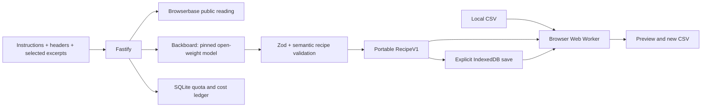

# Architecture and accounting

CSV rows have no automatic path to the backend. RecipeV1 is JSON data: exact required header set, ordered typed operations, assumptions, actual input references and model identity. It contains no executable code. Renames update the column names available to later steps. Schema drift blocks replay; header reordering is supported.

Fastify exposes `/healthz`, `GET /api/status`, `POST /api/sources/read` and `POST /api/recipes/compile`. Compile returns `needs_clarification`, `ready`, `unsupported` or an actionable error. POSTs require same-origin JSON, strict bounded schemas and a 32 KB body limit. An explicit frontend epoch discards stale or cancelled responses; cancellation does not refund a paid request.

SQLite uses WAL, immediate transactions and one service instance. Each compile reserves before paid dispatch, allows one pending inference, and enforces three attempts per session/day (UTC) and per IP/rolling hour. Browser reservations are independent, with the same per-session/IP limits and at most one pending session. A 60-second Browserbase session reserves one whole minute. Public allocation is at most 50 minutes; up to 10 of the initial 60 minutes are set aside for preflight/testing. Actual Browserbase usage rounds short sessions to minutes.

AI public allocation is at most $4, separate from the owner's $1 preflight/evaluation ceiling and $5 total ceiling. Before each compile, the provider registry must match the pinned model/upstream and verified price/limit ceilings: input $0.14/M, output $1/M, context 262,144, maximum output 81,920. The $0.15 reservation covers the conservative sum of a whole context and full native output at those ceilings (< $0.119). No automatic model/provider fallback or paid retry is enabled. Memory and web search are off; there are no external tools or multileg calls.

An observed valid cost can settle a completed reservation, including invalid model output. Missing/uncertain outcomes retain the full reservation. Pending attempts become uncertain after restart. An anomalous cost pauses further AI. These are conservative local reservations, not a provider-account spending cap; a timeout or instruction is never described as a hard cost cap. If pricing/limits cannot be verified, paid dispatch fails closed. External usage of the owner's provider account is not governed by this application's ledger.

The model was deliberately changed from Qwen3-32B to `qwen/qwen3.5-35b-a3b`, pinned to `deepinfra/fp8`, after observed JSON/Bangla failures. Current evaluations retain those failures and a later citation-format correction. All interface questions are English; Bangla/English task input is tested on bounded synthetic cases, not claimed to be universally accurate. Model substitution/self-hosting is possible future engineering work, not a tested feature.
